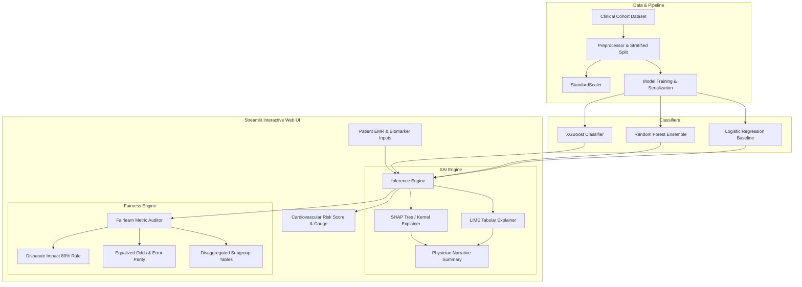

# 🩺 CardioGuard CDSS: Clinical Decision Support System with Model-Agnostic XAI & Fairness Auditing

[](https://www.python.org/)
[](https://streamlit.io/)
[](https://xgboost.readthedocs.io/)
[](https://shap.readthedocs.io/)
[](https://fairlearn.org/)
[](https://opensource.org/licenses/MIT)

> **Academic Project Reference:** Project 66 | **Registration No:** `24ME5A5402`  
> **Faculty Supervisor:** Mr. K. Rajendra  
> **Repository:** [clinicial-xai-fairness-cdss](https://github.com/bethiravikiran143/clinicial-xai-fairness-cdss.git)

---

## 📌 Executive Summary

**CardioGuard CDSS** is an interactive, explainable, and ethically audited Clinical Decision Support System designed for cardiology diagnosis. Modern machine learning models (such as XGBoost and Random Forest ensembles) achieve high predictive capability for cardiovascular disease risk, but their adoption in clinical practice is frequently hindered by **black-box opacity** and **algorithmic bias** across demographic subgroups (e.g., biological sex and age).

This platform bridges that gap by integrating:
1. **High-Performance Black-Box Classifiers** (XGBoost, Random Forest, and Logistic Regression baseline).
2. **Model-Agnostic Local & Global Interpretability (XAI)** via **SHAP** (Shapley Additive exPlanations) and **LIME** (Local Interpretable Model-agnostic Explanations) alongside automated physician clinical narratives.
3. **Algorithmic Fairness & Equity Auditing** evaluated through **Disparate Impact (Statistical Parity 4/5ths Rule)**, **Equalized Odds**, **Equal Opportunity (TPR disparity)**, and **False Positive Rate (FPR disparity)** across protected demographic groups (Biological Sex and Age cohorts).

---

## 🌟 Key Features

### 1. 🔍 Interactive Diagnostic Inference & EMR Interface
- **Electronic Medical Record (EMR) Card**: Track patient identity, MRN, visit number, chief complaints, and attending physician.
- **Dynamic Decision Cutoff**: Real-time adjustable threshold ($0.20 - 0.80$) for customized clinical sensitivity vs. specificity trade-offs.
- **Cardiovascular Risk Gauge**: Instant visual indicator displaying disease probability against clinical thresholds.
- **Pre-configured Clinical Profiles**: Rapid testing with realistic clinical presets (High-Risk Elderly Male, Borderline Female with Atypical Symptoms, Healthy Young Adult).

### 2. 📊 Model-Agnostic Explainability (XAI)
- **SHAP Attribution Waterfall**: Feature-level positive/negative force attributions showing how individual biomarkers push risk above or below baseline.
- **LIME Decision Bounds**: Surrogate local decision rules identifying key physiological threshold ranges.
- **Automated Clinical Narrative**: Machine-generated medical rationale synthesizing the top pathological drivers and protective factors for clinical charts.

### 3. 🌐 Global Interpretability & Cohort Insights
- Cohort-level feature importance ranking via mean absolute SHAP values ($\text{mean } |\text{SHAP}|$).
- Distribution overlays showing ground-truth disease prevalence across key markers like ST depression (`oldpeak`) and maximum heart rate (`thalach`).

### 4. ⚖️ Algorithmic Fairness & Demographic Auditing
- **Disparate Impact Audit**: Verification of the regulatory **80% (4/5ths) rule** for statistical parity.
- **Equalized Odds Assessment**: Ensures balanced true positive and false positive rates across privileged and unprivileged cohorts.
- **Subgroup Metrics Matrix**: In-depth disaggregated analysis of Sensitivity (Recall), Specificity (TNR), Precision (PPV), and Fall-out (FPR) for Female vs. Male and Adult (<55) vs. Senior ($\ge$55) populations.

---

## 🏗️ Architecture & Workflow



---

## 📋 Clinical Biomarkers & Features

| Feature Name | Clinical Description | Range / Categories |
| :--- | :--- | :--- |
| `age` | Patient age in years | 20 – 95 years |
| `sex` | Biological sex | `0`: Female, `1`: Male |
| `chest_pain_type` | Subjective chest pain classification | `0`: Typical Angina, `1`: Atypical, `2`: Non-anginal, `3`: Asymptomatic |
| `resting_bp` | Resting blood pressure on admission | 80 – 220 mm Hg |
| `cholesterol` | Serum cholesterol level | 100 – 600 mg/dl |
| `fasting_bs` | Fasting blood sugar > 120 mg/dl | `0`: $\le$ 120 mg/dl, `1`: > 120 mg/dl |
| `resting_ecg` | Resting electrocardiographic results | `0`: Normal, `1`: ST-T wave abnormality, `2`: Left ventricular hypertrophy |
| `max_heart_rate` | Maximum heart rate achieved during exercise | 60 – 220 bpm |
| `exercise_angina` | Exercise-induced angina | `0`: No, `1`: Yes |
| `st_depression` | ST depression induced by exercise relative to rest | 0.0 – 7.0 mm |
| `st_slope` | Slope of peak exercise ST segment | `0`: Upsloping, `1`: Flat, `2`: Downsloping |
| `num_major_vessels` | Number of major coronary vessels colored by fluoroscopy | 0 – 3 vessels |
| `thalassemia` | Thallium scintigraphy stress test status | `1`: Normal, `2`: Fixed defect, `3`: Reversible defect |

---

## ⚖️ Fairness Metrics & Compliance Standards

1. **Disparate Impact (Statistical Parity Ratio)**:
   $$\text{Disparate Impact} = \frac{P(\hat{Y} = 1 \mid A = \text{unprivileged})}{P(\hat{Y} = 1 \mid A = \text{privileged})}$$
   - **Compliance Criterion**: Ratio must be within $[0.80, 1.25]$ (US EEOC Four-Fifths Rule).

2. **Equalized Odds Difference**:
   $$\Delta_{\text{EO}} = \max \left( |\text{TPR}_{\text{priv}} - \text{TPR}_{\text{unpriv}}|, |\text{FPR}_{\text{priv}} - \text{FPR}_{\text{unpriv}}| \right)$$
   - **Compliance Criterion**: Difference $\le 0.10$ denotes balanced demographic equity.

3. **Equal Opportunity (Sensitivity / TPR Parity)**:
   $$\Delta_{\text{TPR}} = |\text{TPR}_{\text{priv}} - \text{TPR}_{\text{unpriv}}|$$
   - Prevents systematic under-diagnosis in protected demographic groups.

---

## 📁 Repository Structure

```text
clinicial-xai-fairness-cdss/
├── app.py                     # Streamlit CDSS web interface with EMR, XAI, and Fairness tabs
├── run.bat                    # One-click Windows startup batch script
├── requirements.txt           # Python dependencies (Streamlit, XGBoost, SHAP, LIME, Fairlearn, etc.)
├── README.md                  # Comprehensive project documentation
├── data/
│   └── clinical_heart_data.csv # Cardiology dataset with sensitive demographic attributes
├── models/
│   ├── xgb_model.pkl          # Trained XGBoost classifier
│   ├── rf_model.pkl           # Trained Random Forest classifier
│   ├── lr_model.pkl           # Trained Logistic Regression classifier
│   ├── scaler.pkl             # StandardScaler artifact
│   ├── test_data_bundle.pkl   # Train/test validation splits and demographic masks
│   └── metrics_summary.json   # Benchmark metrics (Accuracy, F1, ROC-AUC)
└── src/
    ├── __init__.py
    ├── data_loader.py         # Data generation, loading, and demographic grouping
    ├── train.py               # Model training, scaling, evaluation, and serialization
    ├── xai_engine.py          # SHAP TreeExplainer & LIME tabular explainer implementations
    └── fairness_engine.py     # Disparate impact & Equalized odds auditing algorithms
```

---

## 🚀 Installation & Local Quickstart

### Prerequisites
- Python 3.9, 3.10, or 3.11 installed.
- Git installed.

### 1. Clone the Repository
```bash
git clone https://github.com/bethiravikiran143/clinicial-xai-fairness-cdss.git
cd clinicial-xai-fairness-cdss
```

### 2. Create and Activate a Virtual Environment
**On Windows (PowerShell / Command Prompt):**
```bash
python -m venv venv
.\venv\Scripts\activate
```

**On macOS / Linux:**
```bash
python3 -m venv venv
source venv/bin/activate
```

### 3. Install Dependencies
```bash
pip install --upgrade pip
pip install -r requirements.txt
```

### 4. Launch the CDSS Application
**Option A: Using the Windows batch script:**
Double-click `run.bat` or run:
```cmd
run.bat
```

**Option B: Using Python CLI:**
```bash
python -m streamlit run app.py
```

The application will start at `http://localhost:8501`.

---

## ☁️ Deployment Guide (Streamlit Community Cloud)

1. Fork or push this repository to your GitHub account:
   ```bash
   https://github.com/bethiravikiran143/clinicial-xai-fairness-cdss.git
   ```
2. Log in to [share.streamlit.io](https://share.streamlit.io/).
3. Click **"New App"** and select:
   - **Repository:** `bethiravikiran143/clinicial-xai-fairness-cdss`
   - **Branch:** `main`
   - **Main file path:** `app.py`
4. Click **"Deploy"**. The application will automatically install all dependencies from `requirements.txt` and launch.

*(Note: If pre-trained pickle models encounter Python version discrepancies during deployment, `app.py` automatically initiates an in-session retraining pipeline to guarantee uninterrupted uptime.)*

---

## 📊 Model Evaluation Summary

| Classifier Architecture | Accuracy | Balanced Accuracy | Sensitivity (TPR) | Specificity (TNR) | Precision | F1-Score | ROC-AUC |
| :--- | :---: | :---: | :---: | :---: | :---: | :---: | :---: |
| **XGBoost (Black-box)** | 76.0% | 65.6% | 42.7% | 88.5% | 58.3% | 0.493 | 0.753 |
| **Random Forest Ensemble** | 76.3% | 59.4% | 22.0% | 96.8% | 72.0% | 0.336 | 0.775 |
| **Logistic Regression (Baseline)** | 77.7% | 66.4% | 41.5% | 91.3% | 64.2% | 0.504 | 0.816 |

---

## 🛡️ Clinical & Ethical Disclaimer

> **Disclaimer:** CardioGuard CDSS is an academic research and decision-support prototype. It is not intended to be a sole diagnostic tool for clinical diagnosis without the supervision of a licensed physician. Decisions regarding patient care, pharmacotherapy, or invasive interventions must always be confirmed through direct medical examination and standard clinical protocols.

---

## 📜 License & Citation

Distributed under the **MIT License**. See `LICENSE` for more information.

If you find this project useful in your research or studies, please cite:
```bibtex
@misc{cardioguard_cdss_2026,
  author = {Bethiravikiran},
  title = {CardioGuard CDSS: Clinical Decision Support System with Model-Agnostic XAI and Fairness Auditing},
  year = {2026},
  publisher = {GitHub},
  howpublished = {\url{https://github.com/bethiravikiran143/clinicial-xai-fairness-cdss}}
}
```
